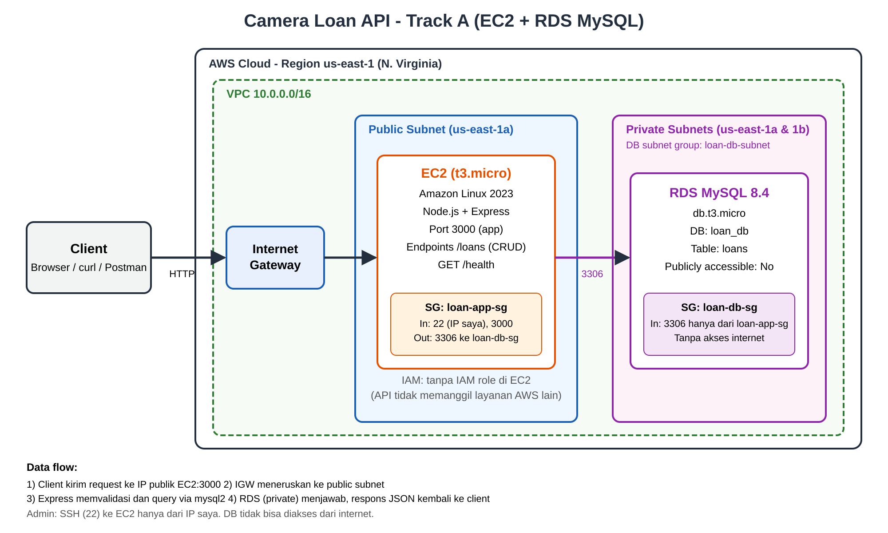

# Camera Loan API

REST API peminjaman kamera untuk **Lab Project AWS Cloud Computing (Week 12)**.
Track: **A - Cloud VM (EC2 + RDS MySQL)**.

## Use case
Mencatat peminjaman kamera: kamera apa, siapa yang meminjam, kapan dipinjam, batas kembali, dan statusnya.

## Arsitektur


- **EC2** (Amazon Linux 2023, tanpa IAM role) di public subnet menjalankan Node.js + Express.
- **RDS MySQL** di private subnet, hanya bisa diakses dari security group EC2 (`loan-app-sg`).
- Detail: lihat [`docs/design-brief.md`](docs/design-brief.md) dan [`docs/deployment-plan.md`](docs/deployment-plan.md).

## Entity: `loans`
| Field | Tipe | Keterangan |
|---|---|---|
| id | INT (PK, auto) | |
| camera_name | VARCHAR(100) | nama kamera |
| borrower_name | VARCHAR(100) | nama peminjam |
| loan_date | DATE | tanggal pinjam |
| due_date | DATE | batas kembali |
| status | ENUM | `BORROWED` / `RETURNED` |

## Endpoint
| Method | Path | Fungsi |
|---|---|---|
| POST | `/loans` | Buat peminjaman baru |
| GET | `/loans` | Daftar semua peminjaman |
| GET | `/loans/:id` | Detail satu peminjaman |
| PUT | `/loans/:id` | Ubah data / status |
| DELETE | `/loans/:id` | Hapus peminjaman |
| GET | `/health` | Cek aplikasi + koneksi DB |

## Menjalankan
```bash
npm install
cp .env.example .env      # isi DB_HOST (endpoint RDS), DB_USER, DB_PASSWORD
mysql -h <DB_HOST> -u <DB_USER> -p < sql/schema.sql
npm run check-db          # tes koneksi
npm start
```

## Contoh request
```bash
curl -X POST http://<EC2_IP>:3000/loans -H "Content-Type: application/json" \
  -d '{"camera_name":"Canon EOS 200D","borrower_name":"Budi","loan_date":"2026-11-24","due_date":"2026-11-27"}'
curl http://<EC2_IP>:3000/loans
curl -X PUT http://<EC2_IP>:3000/loans/1 -H "Content-Type: application/json" \
  -d '{"status":"RETURNED"}'
curl -X DELETE http://<EC2_IP>:3000/loans/1
```

## Struktur
```
src/        kode API (server.js, db.js)
sql/        schema database
scripts/    check-db.js (tes koneksi EC2 -> RDS)
docs/       diagram, design brief, deployment plan, panduan setup AWS
evidence/   screenshot dan output test
```
